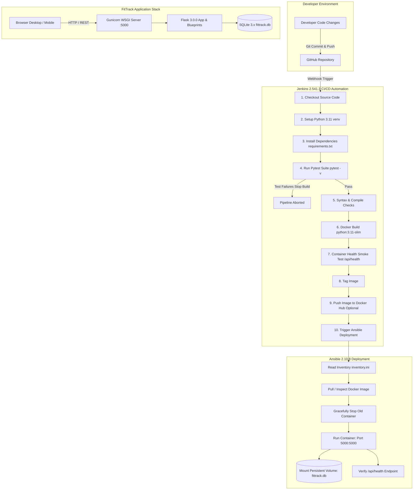

# check 1 FitTrack – Fitness Tracker Web Application with DevOps Automation

[](https://www.python.org/)
[](https://flask.palletsprojects.com/)
[](https://www.sqlite.org/)
[](https://pytest.org/)
[](https://www.docker.com/)
[](https://www.jenkins.io/)
[](https://www.ansible.com/)

---

## 1. Project Abstract & Objectives

**FitTrack** is a full-stack automated Fitness Tracker web application designed for a **DevOps Laboratory final project**. It bridges full-stack Python application engineering with an end-to-end DevOps automation lifecycle—encompassing automated testing, containerization, CI/CD pipeline automation, and configuration management deployment.

### Key Objectives
1. **Full-Stack Application Development**: Deliver a responsive, modern fitness tracker with zero external framework dependencies on the frontend (HTML5, Vanilla CSS3, ES6+ JavaScript, Chart.js) and a modular REST API backend (Python 3.11, Flask 3.0.0, SQLite 3.x).
2. **Quality Assurance & Automated Testing**: Guarantee code quality and data integrity through comprehensive automated tests (Pytest 8.3.5) covering 100% of API endpoints, validation logic, and dashboard KPI calculations against isolated temporary databases.
3. **Containerization & Persistence**: Package the application into a minimal, secure Docker container (`python:3.11-slim`, non-root user, Gunicorn WSGI server) and enforce data persistence across container restarts using Docker volumes for the SQLite database.
4. **CI/CD Automation**: Provide a robust, 10-stage declarative pipeline using **Jenkins 2.541.3** to automate code checkout, environment setup, testing, Docker image building, health-check smoke tests, image tagging, and deployment triggering.
5. **Deployment Automation**: Execute zero-downtime, idempotent deployments with **Ansible 2.10.8** using Docker SDK and `community.docker` automation on both local lab environments and remote production nodes.

---

## 2. Architecture & DevOps Workflow



---

## 3. Technology Stack & Compatibility Matrix

| Component | Technology | Version | Purpose & Compatibility Notes |
| :--- | :--- | :--- | :--- |
| **Frontend UI** | HTML5 / CSS3 / ES6+ JS | Modern W3C | Pure Vanilla implementation without React/Vue. Features glassmorphic dark/light themes. |
| **Visualizations** | Chart.js | 4.4.1 | Dynamic interactive charts for weekly steps, calories, and workout distributions. |
| **Backend Framework** | Flask | 3.0.0 | Lightweight Python WSGI web framework using modular blueprints. |
| **WSGI Server** | Gunicorn | 21.2.0 | High-performance multi-worker UNIX WSGI production HTTP server inside Docker container. |
| **Programming Language**| Python | 3.11 | Modern Python runtime with enhanced performance and typing features. |
| **Database Engine** | SQLite | 3.x | Embedded ACID-compliant database stored in `fittrack.db`. Zero cloud dependencies. |
| **Automated Testing** | Pytest | 8.3.5 | Test framework with fixtures, parameterized tests, and isolated temp SQLite databases. |
| **Containerization** | Docker | 28.5.2 | Multi-stage slim container with non-root security privileges and health probes. |
| **CI/CD Automation** | Jenkins | 2.541.3 | Declarative 10-stage pipeline with parameterized triggers and JUnit reporting. |
| **Deployment Automation**| Ansible | 2.10.8 | Infrastructure-as-code automation using Docker SDK and idempotent task execution. |
| **Version Control** | Git / GitHub | 2.x | Source code management with semantic commits and `.gitignore` safety standards. |

---

## 4. Project Folder Structure

```text
fittrack-devops/
├── app.py                     # Flask application factory and WSGI entry point
├── config.py                  # Environment-driven configuration classes
├── requirements.txt           # Python application dependencies
├── database/
│   ├── db.py                  # SQLite connection pooling & parameterized query helpers
│   └── init_db.py             # Schema definition & dynamic sample data seeding
├── routes/
│   ├── workouts.py            # Workout CRUD REST API endpoints with validation
│   ├── activity.py            # Daily activity tracking endpoints (steps, water, cals)
│   ├── dashboard.py           # Dashboard KPIs, analytics, and demo reset routes
│   └── goals.py               # User fitness goals retrieval and updates
├── services/
│   └── analytics.py           # Statistical aggregation and Chart.js data processing
├── templates/
│   └── index.html             # Responsive Single-Page Application (SPA) frontend
├── static/
│   ├── css/
│   │   └── style.css          # Design system, glassmorphism, responsive styles
│   └── js/
│       └── app.js             # Client-side router, Fetch API, Chart.js, toasts, modals
├── tests/
│   ├── conftest.py            # Pytest fixtures and isolated temporary SQLite DB
│   ├── test_health.py         # Health-check endpoint tests
│   ├── test_workouts.py       # Workout CRUD, validation, and filter tests
│   ├── test_activity.py       # Daily activity tracking tests
│   ├── test_goals.py          # User fitness goals tests
│   └── test_dashboard.py      # Dashboard summary & analytics KPI tests
├── scripts/
│   └── reset_db.py            # Standalone CLI script to reset and re-seed demo data
├── ansible/
│   ├── inventory.ini          # Local and production host targets
│   ├── playbook.yml           # Deployment playbook with container lifecycle tasks
│   └── group_vars/
│       └── all.yml            # Configurable deployment variables
├── Dockerfile                 # Python 3.11-slim production container definition
├── docker-compose.yml         # Single-service compose with persistent SQLite volume
├── Jenkinsfile                # 10-stage Jenkins declarative CI/CD pipeline
├── .dockerignore              # Excludes test artifacts and caches from Docker context
├── .gitignore                 # Excludes venv, sqlite db files, caches, and secrets
├── .env.example               # Template for environment configuration
└── README.md                  # Comprehensive project documentation
```

---

## 5. Fitness Tracker Features

### A. Professional Dashboard
- **Live Metrics**: Total steps today, total ground distance (km), active calories burned, workout duration, and water intake.
- **Goal Completion Rates**: Real-time progress bars calculating daily step goal adherence and weekly workout milestones.
- **Weekly Trend Chart**: Dynamic Chart.js visualization displaying daily steps (bar chart) and caloric expenditure (line chart) over the past 7 days.
- **Recent Workouts**: Quick cards displaying the 5 most recent training sessions with duration, calories, and notes.

### B. Workout Management (Full CRUD)
- **Add Workout**: Form supporting **Running**, **Walking**, **Cycling**, **Strength Training**, and **Yoga**.
- **Input Validation**: Enforces mandatory fields, positive durations, non-negative calories/distances, and valid dates.
- **Workout History**: Real-time search by type or notes, filtering by date, and sorting by duration, date, or calories.
- **Interactive Modals**: Detailed modal inspection, pre-populated edit form, and deletion confirmation dialog.

### C. Daily Activity Tracking
- **Activity Logging**: Record daily step count, hydration in liters (with quick `+0.25L` and `+0.50L` chips), active minutes, calories, and distance.
- **Upsert Capability**: Automatically creates or updates the activity entry for the selected date.
- **Activity Log History**: Visual historical table of daily physical metrics.

### D. Analytics & Visualizations
- **Summary KPIs**: All-time completed workouts, average workout duration, cumulative energy burned, and total distance.
- **Charts**:
  1. *Weekly Step Consistency* (Bar chart vs. target).
  2. *Daily Calorie Expenditure* (Smooth line chart).
  3. *Workout Variety Distribution* (Doughnut chart by activity type).
- **Goal Adherence Bars**: Visual progress meters across daily steps, weekly sessions, and daily hydration.

### E. Goals & Application Settings
- **Customizable Targets**: Adjust daily step goal (default: 8,000), weekly workout goal (default: 5), and daily water goal (default: 2.5 L).
- **Dark & Light Mode**: Live theme switching with persistent client-side `localStorage`.
- **Reset Demo Records**: Restores initial sample workouts and activities dynamically relative to the current calendar date.

---

## 6. Local Installation & Development Guide

### Prerequisites
- Python 3.11+
- Git 2.x
- Docker 28+ (optional for container testing)

### Step 1: Clone Repository
```bash
git clone https://github.com/your-username/fittrack-devops.git
cd fittrack-devops
```

### Step 2: Create and Activate Virtual Environment
**On Linux / macOS:**
```bash
python3 -m venv venv
source venv/bin/activate
```
**On Windows (PowerShell):**
```powershell
python -m venv venv
.\venv\Scripts\Activate.ps1
```

### Step 3: Install Dependencies
```bash
pip install --upgrade pip
pip install -r requirements.txt
```

### Step 4: Initialize SQLite Database
The application automatically creates and seeds `fittrack.db` on first run. To manually initialize or reset sample demo records:
```bash
python scripts/reset_db.py
```

### Step 5: Run the Development Server
```bash
python app.py
```
Open your browser and navigate to **`http://localhost:5000`**.

---

## 7. REST API Documentation

All API endpoints return standard JSON envelopes with appropriate HTTP status codes (`200 OK`, `201 Created`, `400 Bad Request`, `404 Not Found`, `500 Internal Error`).

### 1. Health Check
- **Endpoint**: `GET /api/health`
- **Response `200 OK`**:
```json
{
  "status": "healthy",
  "app": "FitTrack",
  "version": "1.0.0",
  "database": "connected",
  "timestamp": "2026-10-12T13:00:00Z"
}
```

### 2. Dashboard Summary
- **Endpoint**: `GET /api/dashboard`
- **Response `200 OK`**:
```json
{
  "status": "success",
  "data": {
    "today": {
      "date": "2026-10-12",
      "steps": 8650,
      "distance_km": 12.8,
      "calories": 2310,
      "workout_duration_minutes": 45,
      "water_intake_liters": 2.6,
      "step_goal": 8000,
      "step_goal_pct": 100.0,
      "water_goal": 2.5,
      "water_goal_pct": 100.0,
      "weekly_workout_count": 5,
      "weekly_workout_goal": 5,
      "weekly_workout_pct": 100.0
    },
    "weekly_chart": {
      "labels": ["Tue (10/06)", "Wed (10/07)", "Thu (10/08)", "Fri (10/09)", "Sat (10/10)", "Sun (10/11)", "Mon (10/12)"],
      "steps": [7540, 9200, 6800, 10450, 8300, 11200, 8650],
      "calories": [2150, 2400, 1980, 2650, 2220, 2780, 2310]
    },
    "recent_workouts": [
      {
        "id": 7,
        "workout_type": "Cycling",
        "duration": 45,
        "calories": 460,
        "distance": 12.8,
        "workout_date": "2026-10-12",
        "notes": "Mid-day aerobic ride"
      }
    ]
  }
}
```

### 3. Workouts List & Filtering
- **Endpoint**: `GET /api/workouts?type=Running&sort_by=duration&order=desc`
- **Response `200 OK`**:
```json
{
  "status": "success",
  "count": 2,
  "data": [
    {
      "id": 1,
      "workout_type": "Running",
      "duration": 45,
      "calories": 480,
      "distance": 5.5,
      "workout_date": "2026-10-06",
      "notes": "Morning park trail run"
    }
  ]
}
```

### 4. Create Workout
- **Endpoint**: `POST /api/workouts`
- **Request Body**:
```json
{
  "workout_type": "Running",
  "duration": 35,
  "calories": 380,
  "distance": 4.8,
  "workout_date": "2026-10-12",
  "notes": "Tempo run around neighborhood track"
}
```
- **Response `201 Created`**:
```json
{
  "status": "success",
  "message": "Workout created successfully.",
  "data": {
    "id": 8,
    "workout_type": "Running",
    "duration": 35,
    "calories": 380,
    "distance": 4.8,
    "workout_date": "2026-10-12",
    "notes": "Tempo run around neighborhood track"
  }
}
```

### 5. Update Workout
- **Endpoint**: `PUT /api/workouts/8`
- **Request Body**:
```json
{
  "workout_type": "Running",
  "duration": 40,
  "calories": 440,
  "distance": 5.2,
  "workout_date": "2026-10-12",
  "notes": "Extended run with sprint finish"
}
```
- **Response `200 OK`**:
```json
{
  "status": "success",
  "message": "Workout updated successfully.",
  "data": {
    "id": 8,
    "workout_type": "Running",
    "duration": 40,
    "calories": 440,
    "distance": 5.2,
    "workout_date": "2026-10-12",
    "notes": "Extended run with sprint finish"
  }
}
```

### 6. Delete Workout
- **Endpoint**: `DELETE /api/workouts/8`
- **Response `200 OK`**:
```json
{
  "status": "success",
  "message": "Workout with ID 8 deleted successfully."
}
```

### 7. Record Daily Activity
- **Endpoint**: `POST /api/activity`
- **Request Body**:
```json
{
  "activity_date": "2026-10-12",
  "steps": 9500,
  "water_intake": 2.8,
  "active_minutes": 65,
  "distance": 6.8,
  "calories": 2450
}
```
- **Response `200 OK`**:
```json
{
  "status": "success",
  "message": "Activity record for 2026-10-12 updated successfully.",
  "data": {
    "id": 7,
    "activity_date": "2026-10-12",
    "steps": 9500,
    "water_intake": 2.8,
    "active_minutes": 65,
    "distance": 6.8,
    "calories": 2450
  }
}
```

### 8. Update Goals
- **Endpoint**: `PUT /api/goals`
- **Request Body**:
```json
{
  "daily_step_goal": 10000,
  "weekly_workout_goal": 6,
  "daily_water_goal": 3.0
}
```
- **Response `200 OK`**:
```json
{
  "status": "success",
  "message": "Goals updated successfully.",
  "data": {
    "id": 1,
    "daily_step_goal": 10000,
    "weekly_workout_goal": 6,
    "daily_water_goal": 3.0
  }
}
```

---

## 8. Automated Testing with Pytest

The automated test suite uses Pytest 8.3.5 and Flask's test client. Every test execution utilizes an isolated temporary SQLite database file via `tests/conftest.py` so your development or production data is never touched.

### Running All Tests
```bash
pytest -v
```

### Expected Output
```text
============================= test session starts =============================
platform win32 -- Python 3.11.x, pytest-8.3.5, pluggy-1.6.0
rootdir: /path/to/fittrack-devops
collected 25 items

tests/test_activity.py::test_get_activity_list PASSED                    [  4%]
tests/test_activity.py::test_get_activity_by_date PASSED                 [  8%]
tests/test_activity.py::test_create_activity_success PASSED              [ 12%]
tests/test_activity.py::test_update_activity_upsert PASSED               [ 16%]
tests/test_activity.py::test_create_activity_invalid_data PASSED         [ 20%]
tests/test_dashboard.py::test_dashboard_summary_calculation PASSED       [ 24%]
tests/test_dashboard.py::test_analytics_metrics_calculation PASSED       [ 28%]
tests/test_dashboard.py::test_reset_demo_data_endpoint PASSED            [ 32%]
tests/test_goals.py::test_get_goals PASSED                               [ 36%]
tests/test_goals.py::test_update_goals_success PASSED                    [ 40%]
tests/test_goals.py::test_update_goals_invalid_data PASSED               [ 44%]
tests/test_health.py::test_health_check_success PASSED                   [ 48%]
tests/test_workouts.py::test_get_all_workouts PASSED                     [ 52%]
tests/test_workouts.py::test_get_workout_by_id_success PASSED            [ 56%]
tests/test_workouts.py::test_get_workout_by_id_not_found PASSED          [ 60%]
tests/test_workouts.py::test_create_workout_success PASSED               [ 64%]
tests/test_workouts.py::test_create_workout_validation_missing_fields PASSED [ 68%]
tests/test_workouts.py::test_create_workout_validation_invalid_type PASSED [ 72%]
tests/test_workouts.py::test_create_workout_validation_negative_numbers PASSED [ 76%]
tests/test_workouts.py::test_create_workout_validation_invalid_date PASSED [ 80%]
tests/test_workouts.py::test_update_workout_success PASSED               [ 84%]
tests/test_workouts.py::test_update_workout_not_found PASSED             [ 88%]
tests/test_workouts.py::test_delete_workout_success PASSED               [ 92%]
tests/test_workouts.py::test_delete_workout_not_found PASSED             [ 96%]
tests/test_workouts.py::test_filter_and_sort_workouts PASSED             [100%]

============================= 25 passed in 0.78s ==============================
```

---

## 9. Docker Containerization & Persistence

### Build Docker Image
```bash
docker build -t fittrack:latest .
```

### Run Standalone Container
```bash
# Create local data directory for SQLite persistence
mkdir -p ./data

# Run container mounted to host volume
docker run -d \
  --name fittrack-app \
  -p 5000:5000 \
  -v "$(pwd)/data:/app/data" \
  --restart unless-stopped \
  fittrack:latest
```

### Run with Docker Compose
```bash
docker compose up -d --build
```

### Verify Container Health Check
```bash
docker ps
# Status will show (healthy) after startup probe
```

### Verifying SQLite Persistence Across Recreations
To prove that workout records persist when the container is deleted and recreated:
```bash
# 1. Add a test workout
curl -X POST http://localhost:5000/api/workouts \
  -H "Content-Type: application/json" \
  -d '{"workout_type":"Running","duration":50,"calories":520,"distance":6.2,"workout_date":"2026-10-12","notes":"Persistence test session"}'

# 2. Destroy the container
docker compose down

# 3. Bring the container back up (volume is retained)
docker compose up -d

# 4. Verify your workout is still present!
curl http://localhost:5000/api/workouts
```

---

## 10. Jenkins CI/CD Pipeline Setup

The included `Jenkinsfile` provides an enterprise-grade, 10-stage declarative pipeline designed for Jenkins 2.541.3.

### Jenkins Pipeline Stages
1. **Checkout Code**: Clones the specified commit/branch from GitHub.
2. **Setup Python 3.11**: Validates Python runtime and initializes a clean virtual environment.
3. **Install Dependencies**: Upgrades pip and installs packages from `requirements.txt`.
4. **Run Pytest**: Runs `pytest -v --junitxml=pytest-results.xml`. If any test fails, the pipeline aborts immediately.
5. **Syntax & Config Checks**: Compiles Python files to verify syntax and configuration integrity.
6. **Build Docker Image**: Builds the `python:3.11-slim` container tagged with the build number.
7. **Health-Check Validation**: Launches an ephemeral container, probes `http://localhost:5055/api/health`, and deletes the container.
8. **Tag Docker Image**: Assigns release and build tags to the Docker image.
9. **Optionally Push to Docker Hub**: Uses Jenkins credentials `dockerhub-credentials` to securely push to Docker Hub.
10. **Trigger Ansible Deployment**: Invokes Ansible playbook to execute automated rolling deployment.

### Jenkins Setup Instructions
1. **Prerequisites**: Install Jenkins 2.541.3 with standard plugins: *Pipeline*, *Git*, *Docker Pipeline*, *Credentials Binding*, *JUnit*.
2. **Add Credentials**: Navigate to **Manage Jenkins** &rarr; **Credentials** &rarr; **System** &rarr; **Global credentials**:
   - ID: `dockerhub-credentials` (Username with password).
3. **Create Pipeline Job**:
   - Create a **New Item** &rarr; Name: `FitTrack-Pipeline` &rarr; Type: **Pipeline**.
   - Under **Pipeline Definition**, select **Pipeline script from SCM**.
   - SCM: **Git** &rarr; Repository URL: `https://github.com/your-username/fittrack-devops.git`.
   - Script Path: `Jenkinsfile`.
4. **Run Pipeline**: Click **Build with Parameters** &rarr; Choose parameters &rarr; Click **Build**.

---

## 11. Ansible Deployment Automation

Ansible automates configuration management, container deployment, volume binding, and health verification.

### Target Environment Requirements
- Python 3.8+ on the Ansible control node.
- Docker Engine installed on the target machine.
- `community.docker` Ansible collection (optional, playbook includes fallback tasks).

### Inventory Configuration (`ansible/inventory.ini`)
```ini
[local]
localhost ansible_connection=local ansible_python_interpreter=/usr/bin/python3
```

### Running Local Laboratory Deployment
```bash
ansible-playbook -i ansible/inventory.ini ansible/playbook.yml \
  --extra-vars "docker_image_tag=latest target_hosts=local"
```

### What the Playbook Executes:
1. Verifies Docker engine runtime on target node.
2. Creates `/opt/fittrack` application directory.
3. Creates persistent `/opt/fittrack/data` directory for SQLite.
4. Pulls the latest container image.
5. Gracefully terminates any existing container named `fittrack-app`.
6. Launches the new container mapping host port 5000 to container port 5000 and mounting `/opt/fittrack/data:/app/data`.
7. Polls `http://127.0.0.1:5000/api/health` until HTTP 200 with `"status": "healthy"` is confirmed.
8. Prints formatted deployment completion banner.

---

## 12. Git & GitHub Workflow

### Initializing Git Repository
```bash
# Initialize local Git repository
git init

# Configure user identity
git config user.name "Your Name"
git config user.email "your.email@example.com"

# Stage all files
git add .

# Initial commit
git commit -m "feat: initial FitTrack full-stack application and DevOps automation stack"
```

### Pushing to GitHub
```bash
# Add remote origin
git remote add origin https://github.com/your-username/fittrack-devops.git

# Set default branch and push
git branch -M main
git push -u origin main
```

### Feature Branch & Pull Request Flow
```bash
# Create and switch to feature branch
git checkout -b feature/add-cardio-kpis

# Make changes and commit
git commit -am "feat: added heart rate target calculations to analytics"

# Push feature branch
git push -u origin feature/add-cardio-kpis

# Create Pull Request on GitHub UI -> Jenkins CI runs automated tests on PR -> Merge to main
```

---

## 13. Troubleshooting Guide

| Issue | Root Cause | Solution |
| :--- | :--- | :--- |
| `sqlite3.OperationalError: unable to open database file` | Directory permissions on the SQLite database path | Ensure the directory exists and write permissions are granted to the user running Flask (`chown -R fittrack:fittrack /app/data`). |
| `docker build` fails with connection error | Docker daemon is not running | Start Docker Desktop or execute `sudo systemctl start docker` on Linux. |
| Port 5000 is already in use | Previous instance or AirPlay / OS service is occupying port 5000 | Set `PORT=5050` in `.env` or run `docker run -p 5050:5000 fittrack:latest`. |
| Jenkins pipeline fails at Pytest stage | Missing dependency or broken test assertion | Run `pytest -v` locally in the virtual environment to isolate the specific failure before pushing. |
| Ansible health check times out | Container slow to start or port blocked | Increase `health_check_retries` in `ansible/group_vars/all.yml` or inspect container logs using `docker logs fittrack-app`. |

---

## 14. Laboratory Evaluation Summary & Future Enhancements

FitTrack fulfills every DevOps Laboratory requirement:
- ✅ **Python Full-Stack Application**: Python 3.11, Flask 3.0.0, SQLite 3.x, HTML5/CSS3/ES6+ SPA with Chart.js.
- ✅ **Automated Testing**: 25 comprehensive Pytest test cases covering CRUD, validation, calculations, and health checks.
- ✅ **Containerization**: Hardened Dockerfile with non-root user, slim base image, Gunicorn WSGI server, and persistent volume mount.
- ✅ **CI/CD Pipeline**: 10-stage declarative Jenkinsfile with automated gates and container health validation.
- ✅ **Deployment Automation**: Idempotent Ansible playbook with local and remote deployment support.

### Future Enhancements
1. **Prometheus & Grafana Monitoring**: Export metrics from Flask endpoints for real-time latency and request rate dashboards.
2. **Kubernetes Helm Chart**: Deploy multi-replica instances with PersistentVolumeClaims (PVC) and Ingress controllers.
3. **OAuth2 / OpenID Connect**: Optional user authentication support for multi-tenant workout tracking.

---

**Developed for DevOps Laboratory Final Project – 2026**
